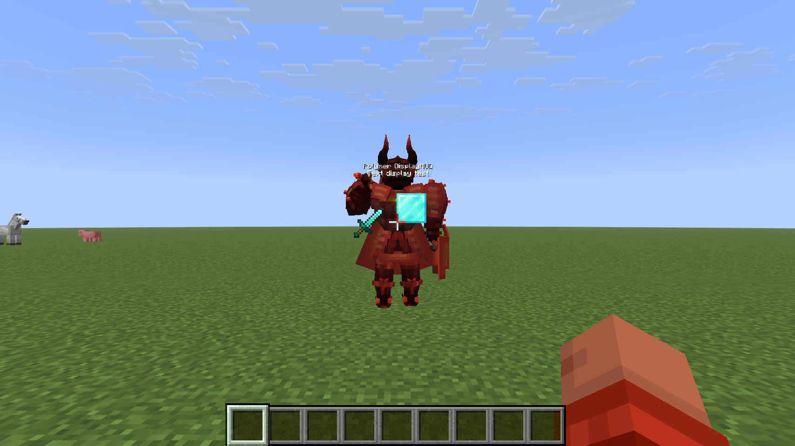
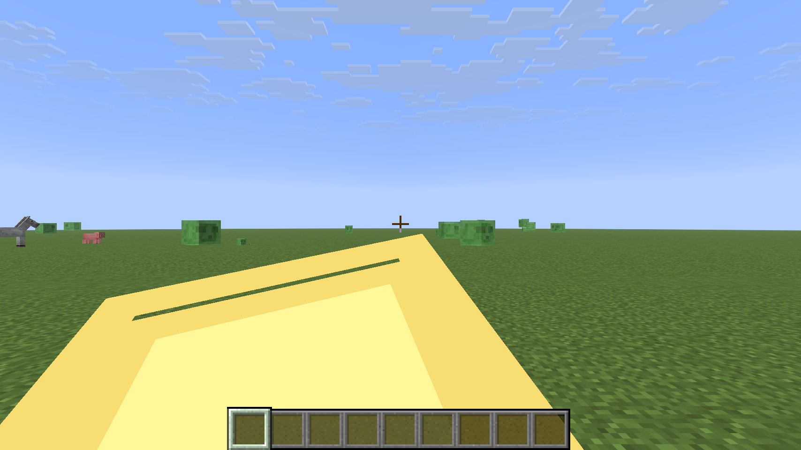
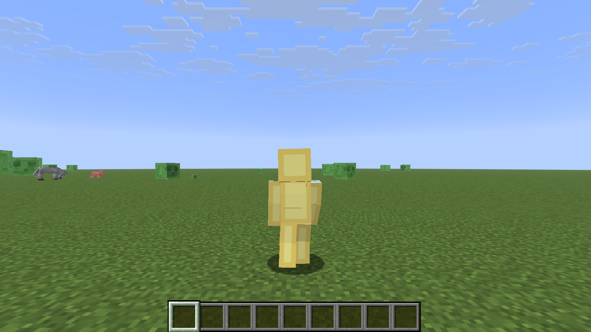

# 11. 작업 계획 – 기본 시스템

기본 시스템을 **세로 슬라이스** 방식으로 만듭니다. 처음부터 모든 직업·무기를 넓게 만드는 대신, 헌터 한 명이 핸드캐논 한 자루로 더미 적 하나를 잡는 구간을 끝까지 완성해 위험한 기술 요소를 먼저 검증합니다.

- 작업 저장소: `~/IdeaProjects/DestinyGuardians` (Fabric 26.3 서버사이드 모드)
- 이슈 ID 규칙: `W<단계>-<번호>`. 커밋·브랜치 이름에 이슈 ID를 붙입니다. 예: `feat/W2-03-input-router`

## 단계 요약

| 단계 | 목표 | 완료 기준 | 선행 |
|---|---|---|---|
| W1 | 기반 세팅 | 세 라이브러리를 함께 넣은 서버가 뜨고, 바닐라 클라이언트가 리소스팩을 받아 접속 | – |
| W2 | 수호자 데이터·입력 | 입력이 능력 이벤트로 바뀌고 쿨타임·게이지가 저장됨 | W1 |
| W3 | 첫 플레이 구간 (헌터 + 핸드캐논) | 2단 점프, 구르기, 사격, HUD, 더미 적 처치까지 한 번에 플레이 가능 | W2 |
| W4 | 확장 | 타이탄·워록 이동, Arc 능력 세트, 궁극기 포스트 이펙트, 스킬 트리 UI | W3 |
| PoC | 병행 검증 | 3인칭 카메라·F5 자기 모델·포스트 이펙트+HUD 결과 기록 | W1 |

## W1. 기반 세팅

| ID | 작업 | 완료 기준 | 상태 |
|---|---|---|---|
| W1-01 | 저장소·Gradle 설정 (Loom 1.18.2, Java 25, minigame-lib submodule + includeBuild) | `./gradlew build` 성공 | ✅ 2026-10-22 |
| W1-02 | 의존성 연결: Polymer 0.18.4, BetterModel 3.5.1, minigame-lib 2.0.0 | 서버 로그에 세 모드 버전 출력 | ✅ 2026-10-22 |
| W1-03 | 리소스팩 자동 생성·자동 호스팅(autohost) 설정 | 바닐라 클라이언트 접속 시 팩 적용 | ✅ 2026-10-22 (기본 설정으로 동작) |
| W1-04 | 셰이더 공존 확인: DisplayHud 테스트 HUD(`/displayhudtest`) + BetterModel 테스트 모델을 한 화면에 | OpenGL·Vulkan 모두 정상 표시, 셰이더 컴파일 오류 없음 | ✅ OpenGL / ⏳ Vulkan |
| W1-05 | 개발용 명령 `/destiny debug model·limb·clear` | 명령 동작 | ✅ 2026-10-22 (상태 출력은 W2에서 추가) |
| W1-06 | CI: 빌드 + 단위 테스트 | 푸시 시 빌드 통과 | |

## W2. 수호자 데이터·입력

| ID | 작업 | 내용 | 완료 기준 |
|---|---|---|---|
| W2-01 | 데이터 등록부 | `data/destiny/{abilities,weapons,classes}/*.json`을 읽어 등록. 재로드(`/reload`) 지원 | 잘못된 JSON에 오류 로그, 정상 JSON 등록 |
| W2-02 | 수호자 상태 | 직업, 서브클래스 장착(궁극기·수류탄·근접·직업 능력·측면·파편), 쿨타임, 궁극기 게이지. Fabric 데이터 첨부로 저장 | 재접속·사망 후 유지 |
| W2-03 | 입력 라우터 (GCB + 바닐라) | 바닐라 입력 + GCB 키·시점 이벤트를 플레이어별 프로필로 `GuardianAction`에 매핑 ([12](12_스킬_입력_GCB_바닐라_혼용.md) 5장) | 두 경로 모두 로그로 구분됨, 같은 틱 중복 실행 없음, 바닐라 동작(F·Q)은 취소 |
| W2-03a | GCB-server 연결 | 26.3 변경분 커밋·푸시 → submodule + includeBuild | 빌드 성공, `gcb$hasMod` 확인 |
| W2-04 | 입력 조합 규칙 | 공중 점프, 웅크리기 두 번(간격 틱 설정값), 웅크리기+F | 조합 판정 단위 테스트 |
| W2-05 | 쿨타임·게이지 틱 | 서버 틱마다 쿨타임 감소, 궁극기 게이지 충전(시간·처치) | 수치 단위 테스트 |
| W2-06 | 능력 실행 틀 | `Ability` 인터페이스, 실행 조건(쿨타임·지면·상태), 이벤트 틱 스케줄 | 더미 능력으로 확인 |

## W3. 첫 플레이 구간 (헌터 + 핸드캐논)

| ID | 작업 | 내용 | 관련 문서 |
|---|---|---|---|
| W3-01 | 헌터 2단 점프 | 공중 점프 입력 → 상향 속도 부여, 낙하 피해 무시 | 메인 3-1-1 |
| W3-02 | 헌터 구르기 | BetterModel `guardian_common` / `common_roll`, 입력 방향, 무적 틱, 실제 이동은 속도 부여 | 04 |
| W3-03 | 무기 아이템 | Polymer 아이템, 아이템 모델 정의(hip / ads / reload), `custom_model_data` 상태 전환 | 03 |
| W3-04 | 사격 | 우클릭 유지 감지, RPM → 누적 게이지, 서버 레이캐스트, 머리 판정, 탄 궤적 파티클 | 메인 3-2 |
| W3-05 | 반동·정조준·재장전 | 시점 상대 회전, 좌클릭 토글 + FOV 축소, Q 재장전 단계 | 03, 메인 3-2-1 |
| W3-06 | 전투 HUD | DisplayHud: 쿨타임 3칸, 궁극기 게이지, 탄약, 적중 표시 | 08 |
| W3-07 | 더미 적 | 보이지 않는 기반 엔티티 + BetterModel 모델, `h_weakpoint` 머리 판정, 피격·사망 애니메이션 | 05 |
| W3-08 | 플레이 테스트 | 핑 0 / 100ms에서 손맛 기록, 문제 목록 작성 | – |

## W4. 확장 (W3 완료 후 상세화)

- 타이탄 제트팩 상승, 워록 활공
- Arc 능력 세트 (수류탄·근접·직업 능력·궁극기 1종씩)
- `PostEffectManager` + `destiny:super/arc_active`, `destiny:state/dodge`
- 스킬 트리 UI (커서 방식 결정 후)
- 자동소총·기관단총·로켓 발사기

## PoC (W1 이후 병행)

| ID | 질문 | 결과에 따른 결정 |
|---|---|---|
| P-01 | F5(3인칭)에서 본인 limb 모델이 어떻게 보이나 | ✅ 확인: 1인칭에서 화면을 가림 → 시점별 표시 (12-6) |
| P-02 | 카메라가 다른 엔티티에 붙어 있을 때 이동 입력·마우스 회전이 서버로 오나 | 서버 추적 3인칭 카메라 채택 / 폐기 |
| P-03 | 블러 포스트 이펙트에서 DisplayHud 영향과 깊이 마스크(HUD 깊이 ≈ 0.5)로 제외 가능한가 | 07-4 대응 방식 확정 |
| P-04 | DisplayHud 신호 픽셀로 `end_of_frame`에 값 전달 | 07-3 방법 C 채택 / 방법 A로 대체 |
| P-05 | GCB 경로 전체 (키·시점 이벤트, 프로필 전환, 시점별 limb 표시) | 12-10 |
| P-06 | 탑승형 3인칭 (이동·조준·지연) | 지속형 궁극기 3인칭 채택 여부 |
| P-07 | GCB 모양 파티클 vs 서버 점 파티클 패킷 수 | VFX 전송 방식 |

## 착수 전 결정 필요

| 항목 | 필요 시점 |
|---|---|
| ~~능력 입력 방식~~ → **GCB + 바닐라 혼용으로 결정** ([12](12_스킬_입력_GCB_바닐라_혼용.md)). 남은 것: 근접 능력의 바닐라 조합 | W2-03 |
| 핸드캐논 RPM 순서 (공격형 120·적응형 150 / 원래 표) | W3-04 |
| 바닐라 발광(glowing) 효과 사용 여부 (minigame-lib이 `entity_outline` 효과를 덮어씀) | W3-07 |

## 검증 기록

### 2026-10-22 – W1-03·W1-04·W1-05·P-01

환경: 테스트 서버 `./gradlew runServer` (오프라인 모드, 평지) + Copper Golem 비전 클라이언트 26.3 (`MinigameQA`, Apple M4, **OpenGL**). 화면은 실제 프레임버퍼 캡처.

| 항목 | 결과 | 근거 |
|---|---|---|
| 리소스팩 | 클라이언트가 접속 시 팩을 받아 적용. 셰이더 링크 경고(사용하지 않는 출력)만 있고 컴파일 오류 없음 | 클라이언트 로그 |
| DisplayHud | 텍스트·아이템·블록 HUD가 화면에 고정됨. 시점을 60° 돌려도 같은 위치 |  |
| BetterModel + DisplayHud 공존 | `demon_knight` 모델(walk 반복)과 HUD가 한 화면에 정상 표시. HUD가 모델 앞에 그려짐 |  |
| limb 구르기 (3인칭) | `steve`/`roll` 재생 중 실제 플레이어가 숨겨지고 limb 모델이 구르는 자세로 보임 |  |
| **limb 1인칭 (P-01)** | 본인 limb 모델이 카메라 앞을 크게 가림 → 본인에게는 숨겨야 함 |  |
| limb 스킨 | 오프라인 계정이라 스킨이 입혀지지 않고 기본 텍스처로 보임. 정식 계정 스킨은 미확인 |  |

발견한 문제
- BetterModel의 `/bm` 명령(cloud)은 콘솔·`execute as`로 실행되지 않음 → `/destiny debug` 명령으로 대체 (W1-05)
- `debug model`의 모델이 플레이어를 등지고 생성됨 → 회전 +180 제거 (화면 재확인 전)
- 서버 화이트리스트가 켜져 있어 오프라인 테스트 계정이 거부됨 → `whitelist off`로 진행

남은 검증: Vulkan 렌더러, 정식 계정 스킨, 다른 플레이어 시점(2인 접속)

## 헌터 구현 체크포인트 (2026-10-22)

상세 변경·검증은 [13. 헌터 구현 로그](13_헌터_구현_로그.md)에 누적합니다.

| ID | 헌터 범위 현재 상태 | 범위 한계 |
|---|---|---|
| W2-01·W2-06 | ✅ 헌터 능력 13종 등록, JSON 수치 재로드, 실행 틀 | 무기·적 데이터 등록부 확장은 이후 |
| W2-02 | ✅ 직업·장착·쿨타임·궁극기 데이터 첨부 | 측면·파편·트리 UI는 이후 |
| W2-03·04 | ✅ 바닐라 입력·GCB 어댑터·조합·중복 억제 | GCB 실클라이언트 전송 QA 별도 |
| W2-03a | ✅ 로컬 GCB 소스 includeBuild | submodule 배포·원격 push 미실행 |
| W2-05 | ✅ 쿨타임·시간/처치 충전 | 밸런스 플레이 테스트 이후 |
| W3-01·02 | ✅ 헌터 점프·회피·BetterModel limb | 기본 템플릿 리그, 최종 아트 교체 가능 |
| W3-03·04·05 | ⏳ 일반 핸드캐논 시스템 | 궁극기 장비 모델·서버 사격은 구현 |
| W3-06 | ✅ 능력 쿨타임·궁극기 DisplayHud | 일반 무기 탄약·적중 표시 이후 |
| W3-07·08 | ⏳ 전용 적 모델·지연 플레이 테스트 | 현재 회귀 대상은 바닐라 Husk |
| W4 일부 | ✅ Arc·Solar·Void 헌터 능력/궁극기 포스트 이펙트 | 타 직업·스킬 트리·추가 무기 이후 |
