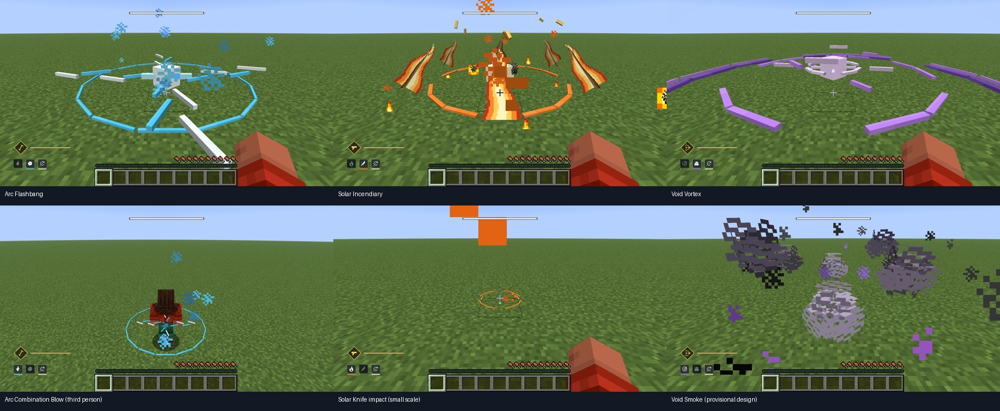

# 16. 헌터 VFX 구현 — H13

> **H13 기록 문서. 현재 런타임은 H14 모델 ID를 사용합니다.** 6종 훅·수명·피해/물리는 유지하며,
> 시각 에셋·테스트 예산의 최신 내용은 [17. 디테일 개정](17_헌터_VFX_디테일_개정.md)을 따릅니다.


작성일: 2026-10-22. 현재 작업 트리의 스크립트·에셋·런타임·능력 훅을 읽어 기록한 구현 상태다.
Solar 형상과 Vortex 루프를 실화면 피드백으로 수정한 뒤, 최종 에셋으로 **GameTest52/52·JUnit10/10 및 build**가 통과했다.
실제 능력6종 표시·20TPS 프레임버퍼 확인을 포함한 최종 증거와 미검증 범위는 8절에 구분한다.

## 1. 범위: 능력 6종 → 효과 모델 4종

수류탄 3종과 근접 3종의 폭발·타격·장판에 BetterModel 위치 기반 효과를 연결했다.
H12의 날아가는 소품 5개와 별개다. Arc는 맨손 근접을 유지하고, 투사체 소품·플레이어 limb를 추가하는 작업이 아니다.

| 능력 / 훅 | `HunterVfx.Kind` | 모델 ID | 크기 인자 / 요청 수명 |
|---|---|---|---|
| Arc 섬광탄 폭발 | `ARC_FLASH` | `destiny_vfx_arc_h13` | 능력 `radius` / 16틱 |
| Arc 연속 타격, 근접 작업 `age == 3` | `ARC_STRIKE` | `destiny_vfx_arc_h13` | 1.1 / 16틱 |
| Solar 소이탄 폭발 | `SOLAR_BURST` | `destiny_vfx_solar_h13` | 능력 `radius` / 22틱 |
| Solar 투척 칼 충돌 | `SOLAR_KNIFE` | `destiny_vfx_solar_h13` | 0.65 / 22틱 |
| Void 소용돌이 발생 | `VOID_VORTEX` | `destiny_vfx_vortex_h13` | 능력 `radius` / `duration_ticks` |
| Void 연막탄 충돌 | `VOID_SMOKE` | `destiny_vfx_smoke_h13` | 능력 `radius` / `duration_ticks` |

현재 능력 JSON의 수류탄 반경은 4.5, 소용돌이 수명은 60틱, 연막 반경/수명은 3.5/100틱이다.
이 값은 튜닝으로 바뀔 수 있다. 표의 크기는 tracker 배율 인자이며 피해 반경이나 실제 렌더 외곽과의 정확한 일치를 보장하지 않는다.
수류탄 발생점은 충돌점에서 Y+0.2, 단검·연막은 충돌점, Arc 근접은 진행 중 플레이어의 앞쪽 중심이다.
Arc 근접 효과는 적 적중 여부와 무관하게 해당 작업의 3틱 지점에 요청된다.
단검은 엔티티/지형 충돌 경로에서 효과를 요청하고, 실제 피해·연소는 기존 엔티티 명중 분기에 남는다.

Arc 두 능력은 동일한 전격 모델, Solar 두 능력은 동일한 화염 모델을 다른 크기로 공유한다.
**서로 다른 모델 6개를 만든 것이 아니다.** Void는 소용돌이와 연막의 실루엣을 분리했다.

## 2. 레퍼런스와 독자 제작의 경계

근거는 [15. 헌터 VFX 레퍼런스](15_헌터_VFX_레퍼런스.md)다. 조사 당시 관찰과 한계는 보존한다.
소이·소용돌이의 실제 게임 스크린샷, Arc Hunter 표지·Flashbang 카드를 속성별 조형 방향에 사용했다.
원작 메시·텍스처·셰이더는 사용하지 않고 큐브 형상과 작은 색상 아틀라스를 직접 생성한다.

- Arc: 청백색 중심, 가는 꺾인 전격, 확장되는 분절 파동. 실제 Combination Blow 타격 프레임을 복제한 결과는 아니다.
- Solar: 황백색 중심, 그룹마다 교차하는 얇은 cutout 화염 평면2개와 잔불. 흰색/노랑/주황/빨강 화염 텍스처를 쓰며, 첫 실화면의 기둥 같은 인상을 줄이도록 낮게 바깥쪽·위쪽으로 이동한다. 단검에 작은 화염 모델을 쓰는 것은 이번 구현의 선택이며 특정 Destiny knife 변형 검증 결과가 아니다.
- Vortex: 분홍빛 밝은 중심, 여러 보라색 호와 서로 다른 회전 트랙. 내부 호는 1초 루프에서 Y축 0° → −180° → −360°로 한 바퀴 회전한다. 원작 영상의 회전 방향·속도를 측정한 것이 아니다.
- Smoke: 회보라색 덩어리와 뚫린 아틀라스 픽셀, 부풀고 이동하는 연무. 실제 Hunter 연막 프레임이 없어 원작 충실도는 잠정이다.

아래 HEX와 애니메이션 초 단위 값은 **직접 작성한 H13 값**이다. Bungie 공식 팔레트나 원작에서 실측한 타이밍으로 표시하지 않는다.

## 3. 제작 스크립트와 에셋

- `scripts/build_hunter_vfx.js`: 빈 Blockbench Generic(`free`) 프로젝트에서 root/효과별 그룹·큐브·32×32 임베디드 아틀라스를 작성한다. Undo 편집을 사용하고 효과별 본 트랙 정보를 반환한다.
- `scripts/export_hunter_vfx.py`: 로컬 Blockbench MCP에 연결해 새 프로젝트 4개를 만든다. 애니메이션을 생성하고 이름을 `spawn`/`loop`로 맞춘 뒤 codec JSON을 받아 편집본과 번들본을 저장한다.
- 편집본: `art/blockbench/vfx/<모델 ID>.bbmodel`.
- 번들 기본값: `src/main/resources/destiny/vfx/<모델 ID>.bbmodel`.
- 목록·제작 정보: `art/blockbench/vfx/manifest.json`.

| 모델 ID | 큐브 / 렌더 그룹¹ | 클립 | 팔레트 (밝음 → 어두움) |
|---|---|---|---|
| `destiny_vfx_arc_h13` | 35 / 6 | `spawn`, 0.8초, 1회 | `#F4FCFF`, `#B7F3FF`, `#51CFFF`, `#2477BC` |
| `destiny_vfx_solar_h13` | 32 / 8 | `spawn`, 1.1초, 1회 | `#FFF3BE`, `#FFD15B`, `#FF872B`, `#BE351A` |
| `destiny_vfx_vortex_h13` | 53 / 4 | `loop`, 1초, 반복 | `#F2D7FF`, `#C589FA`, `#7446B9`, `#271B42` |
| `destiny_vfx_smoke_h13` | 24 / 6 | `loop`, 2초, 반복 | `#B4A8C6`, `#877991`, `#62596F`, `#443D54` |

¹ 매니페스트의 `render_bones`/제작 그룹 수다. 실제 BetterModel의 비어 있지 않은 렌더 그룹도8개 이하임을 GameTest에서 검사했다.
4개 편집본·번들본·실제 서버 설치본·GameTest 설치본의 바이트 일치를 확인했다. 클립 등록도 실행 검증했다.

실제로 사용한 재생성 명령은 다음과 같다. 새 Blockbench 프로젝트4개와 위 에셋·미리보기를 만드는 명령이다.

```sh
rtk proxy python3 scripts/export_hunter_vfx.py
```

내보내기 스크립트의 미리보기 경로는 `docs/qa/2026-10-22/vfx_h13_blockbench_{arc,solar,vortex,smoke}.png`다.
Blockbench 미리보기4개도 육안 확인했다. 별도로 실제 게임 화면6종을 확인했으며 미리보기가 이를 대체하지 않는다.

## 4. 기본 모델 설치와 렌더링

`DestinyGuardians.onInitialize()`가 `HunterVfxAssets.prepare()`를 호출한다.
`HunterVfxAssets.install()`은 번들 `.bbmodel`을 `config/bettermodel/models/`에 **없는 파일만** 복사한다.
기존 파일을 덮어쓰지 않으므로 설치 후 같은 이름의 번들을 수정해도 서버의 기존 아티스트 파일에 자동 반영되지 않는다.
새 설치는 실제 서버에서, 기존 아티스트 파일 보존은 임시 디렉터리 JUnit에서 확인했다.
IO 실패는 로그로 남기고 게임플레이 서버의 초기화를 의도적으로 중단하지 않는다.
초기 설치 이후 BetterModel 등록 및 Polymer 팩 생성 완료를 실제 로그와 GameTest에서 확인했다.

`HunterVfx.play()`는 BetterModel 모델과 해당 클립을 찾고, 위치 기반 `DummyTracker`를 생성한다.
단발은 `PLAY_ONCE`, 지속 효과는 `LOOP`로 시작하며 밝기는 `(15, 15)`로 지정한다.
렌더링 수단은 BetterModel의 애니메이션되는 아이템 디스플레이다.
이는 full-bright 큐브와 텍스처이며, 동적 광원·가산 블렌딩·볼류메트릭 연기·새 post effect 셰이더 구현이 아니다.
Smoke의 빈 픽셀도 전체 효과의 연속적인 알파 페이드와 구분한다.

제작 좌표 16단위를 1블록으로 보는 배율 계약을 사용한다. 단발은 모델 내부 scale 트랙으로 줄어들고,
지속 효과는 모델 루프에 더해 런타임에서 처음 4틱 동안 확대, 마지막 8틱 동안 축소하도록 계산한다.
짧은 수명에서는 두 구간이 겹칠 수 있다. 이 런타임 scale은 투명도 보간이 아니다.

## 5. 수명·관찰자·정리 훅

`HunterVfx`는 서버 스레드에서 활성 tracker를 관리한다.

| 항목 | 현재 코드의 동작 | 실행 판정 |
|---|---|---|
| 수명 | Arc 최대 16틱, Solar 최대 22틱, Vortex/Smoke 최대 200틱. 요청 수명은 각 상한으로 clamp | GameTest 통과·실제 소멸 확인 |
| 전체 예산 | 소유자당 4개, 서버 전체 24개. 새 tracker 생성 전 오래된 효과부터 제거 | 소유자4개 GameTest 통과 / 전체24개 부하 미검증 |
| 관찰자 | 같은 월드, 연결된 플레이어 중 발생 위치 48블록 이내. 최초 즉시, 이후 5틱마다 추가/제거 | 1인 실제 표시 확인 / 진입·이탈·경계 미검증 |
| 자동 만료 | 서버 tick age·소유자 생존/제거/접속/월드 상태·tracker 닫힘을 검사 | GameTest 통과 |
| 소유자 정리 | `AbilityService.cleanup()` → `HunterVfx.cancelOwned()` | GameTest + 실제 속성 변경1→0 |
| 서버 종료 | `AbilityService`의 `SERVER_STOPPING` → `HunterVfx.clearAll()` | 정상 종료 확인 / 활성24개 종료 부하 미검증 |
| 예외 정리 | 생성 실패 시 `finally` 정리, tick 예외 시 제거, 관찰자별 remove 후 tracker close | 소스 검토 / 백엔드 고장 주입 미검증 |

`AbilityService.tick()`에서 `Tasks.tickAll()` 다음에 `HunterVfx.tick()`을 호출한다.
효과 수명은 능력 `Tasks`와 별도로 유지되므로 작업 종료만으로 시각 효과가 즉시 사라지는 구조는 아니다.
기존 사망·접속 종료·차원 변경 이벤트와 직업/속성 변경 명령이 부르는 `cleanup()`에 소유자 정리를 연결했다.
서버 종료의 전체 정리는 실제 접속자 목록에 없는 소유자의 효과도 대상으로 한다.

이 상한은 4개 모델의 개수가 아니라 동시에 살아 있는 tracker 수다.
최대 본 수를 곱한 표시 부하나 6인 동시 시전의 FPS/TPS는 아직 측정하지 않았다.

## 6. 파티클 대체 경로와 게임플레이 분리

`play()`가 `false`이면 모델 미존재·클립 부재·잘못된 입력·생성 실패 등에 대한 기존 파티클 경로를 사용한다.
능력 코드에서 모델 성공 여부에 따라 다음처럼 장식을 줄인다. 수치는 현재 소스의 호출 인자다.

| 능력 | 모델 시작 성공 시 | 시작 실패 시 |
|---|---|---|
| Arc 섬광 | burst 18, 기존 ring 생략 | burst 60 + ring 40 |
| Solar 소이 | burst 18 + lava 4 | burst 70 + lava 12 |
| Void 소용돌이 | 기존 주기적 ring/portal 생략 | 2틱 간격 ring 24 + portal 12 |
| Arc 근접 | burst 8; 기존 준비 spark/타격 line 유지 | burst 30; 준비 spark/타격 line 유지 |
| Solar 단검 | burst 6 | burst 20 |
| Void 연막 | 4틱 간격 smoke 2 + dust 1 | 매 작업 tick smoke 6 + dust 4 |

`modeled`는 효과를 시작할 때 결정되는 값이다. 시작 성공 후 예산 퇴출·후속 tracker 오류·상한 만료가 발생해도
지속 효과의 기존 파티클을 자동 재개하는 재시도 로직은 현재 없다.
200틱보다 길게 튜닝한 지속 능력에서는 시각 효과가 먼저 종료될 수 있다. 이를 무조건적인 실시간 복구 보장으로 설명하지 않는다.

변경된 능력 diff는 효과 호출·파티클 수/빈도 분기에 한정된다.
피해·끌림·실명/연소/억제·투명·쿨타임과 기존 투사체 경로는 별도 로직에 남아 있다.
최종 에셋으로 기존 능력 회귀를 포함한 GameTest52개가 통과했다. 이는 모든 실전 전투/밸런스의 무영향을 증명하는 것은 아니다.
원작의 바운스·점화 조건을 새로 구현한 작업도 아니다. 현 구현의 동작과 15번 문서의 원작 설명을 구분한다.

## 7. 디버그 훅과 확인 절차

`DebugCommands`의 기존 권한 제한 아래에 다음 명령이 추가되어 있다.

```text
/destiny debug vfx <player> arc_flash|arc_strike|solar_burst|solar_knife|void_vortex|void_smoke
/destiny debug vfx-status
/destiny debug clear
```

첫 명령은 플레이어 전방 약 6블록 위치에서 실제 VFX factory만 호출하는 무피해 미리보기다.
`played=true` 응답은 factory의 시작 결과이며, 실제 클라이언트 표시 확인을 뜻하지 않는다.
`vfx-status`는 활성 tracker 수를 출력한다. `clear`는 VFX와 기존 디버그 모델/limb도 함께 정리한다.
미리보기 후에는 실제 수류탄·근접 입력을 각각 사용해 훅·피해·쿨타임·발생 위치를 별도로 확인해야 한다.

## 8. QA — H13 최종 검증

2026-10-22 **13:15:58 KST**, Java25에서 `rtk proxy ./gradlew runGameTest build --console=plain` 성공.
최종 재내보낸 에셋 기준 **GameTest52/52, JUnit10/10** 통과했다.
H12 결과를 재사용하지 않았다. 최초 Solar가 기둥처럼 보이는 것을 실제 화면에서 확인한 뒤,
교차 cutout 면·불규칙 화염 텍스처로 교정했고 다시 빌드/검증했다.

| 검사 | 최종 결과 / 한계 |
|---|---|
| GameTest52개 | 기존 능력 회귀40 + VFX12. 실제 BetterModel 모델/클립 등록, 렌더 본 ≤8, 6종 생성, TTL, 200틱 제한, 소유자4개 퇴출, 잘못된 입력/차원, cleanup, 사망/제거/차원/접속 종료 검사 통과 |
| JUnit10개 | 기존8 + VFX2. 원본/번들 바이트 일치, 큐브/본 예산, 유한 키프레임, 내장 아틀라스, 최초 설치·재설치·아티스트 파일 보존 통과 |
| 서버 설치/팩 | 기본4개 설치, BetterModel 등록 및 Polymer 팩 생성 성공. 실제 서버·GameTest 설치본이 최종 편집본과 바이트 일치함도 확인 |
| 실제 화면 | Copper Golem Vision26.3, Apple M4 Pro/OpenGL, 1708×956 PNG 육안 확인. 정상20TPS에서 `guardian action`으로 능력6종 실제 시전. 디버그 미리보기로 대체하지 않음 |
| 형태/애니메이션 | Arc 섬광·작은 근접 강조, Solar 방사형 cutout 화염·작은 단검 충돌, Vortex 밝은 코어/회전 호, Smoke 점묘 cutout 덩어리 확인. 단검 초기 파티클이 화면 일부를 크게 가리는 구간은 남아 있음 |
| 소멸/정리 | 실제 시전 후 `Active Hunter VFX=0`. 연막 미리보기1개를 띄운 뒤 속성 변경하여1→0 확인. 정리 후 실제 PNG 확인. 서버 정상 종료 |
| 세션 복구 | 본인 비전 클라이언트 PID97685 SIGTERM 종료, Gradle exit143은 의도된 종료. 원본 options.txt 5157바이트 일치 복구, 두 포트 비점유 확인. Blockbench는 기존7개 탭 보존 + 최종 VFX4개만 유지 |
| 남은 검증 | 2인 관찰자/늦은 진입/48블록 경계, 전체24개 상한 부하·FPS/TPS, 밤/동굴, 런타임 모델 누락 강제 주입은 미검증. 코드를 검토한 것과 실증 통과를 구분 |

증거: [QA 안내](../qa/2026-10-22/README.md), [빌드/52 GameTest](../qa/2026-10-22/vfx-h13-build-gametest.txt),
[조건·해시](../qa/2026-10-22/vfx-h13-validation.json), [프레임 시각/능력별 기록](../qa/2026-10-22/vfx-h13-frame-captures.json).



PNG는 원본 프레임버퍼이고, 모음 JPG와 WebP는 검토용 축소본이다. WebP는 실제 캡처 간격을 유지한 저빈도 기록이며
원작 영상이나 고정60FPS 녹화가 아니다. Arc 근접만 본인 뒤쪽3인칭, 나머지는1인칭으로 촬영했다.

### 경고와 범위

새 VFX 모델·텍스처 누락/백엔드 예외는 관찰되지 않았다. 기존 HUD/궁극기 장비의 `particle` 텍스처 참조 경고,
`minecraft:end_of_frame` 미존재 포스트 효과 경고, 오프라인 계정 Realms 인증, 팩 캐시 재다운로드 및 OpenGL varying 경고는 남는다.
이번 작업은 해당 경고나 기존 궁극기 포스트 체인을 수정한 작업이 아니다. 전체 셰이더/클라이언트 로그 무경고로 보고하지 않는다.
테스트 레이아웃 검사기는 성공했으나 26.3의 `src/gametest` 구조를 찾지 못해 plain unit만 있다는 경고1개를 냈다.
실제 `runGameTest` 로그52개 통과가 GameTest 근거다.

**원작의 정확한 시간·볼륨·광학적 발광 일치, Hunter 연막/개별 근접 VFX의 충실도,
궁극기 전용 신규 모델 VFX는 완료하지 않았다.** 다음 순서는 정확한 근접/연막 레퍼런스 추가,
Arc Staff·Golden Gun·Shadowshot 전용 조형, 선택적 posteffect bloom/광학 처리와 다인 부하 검증이다.
