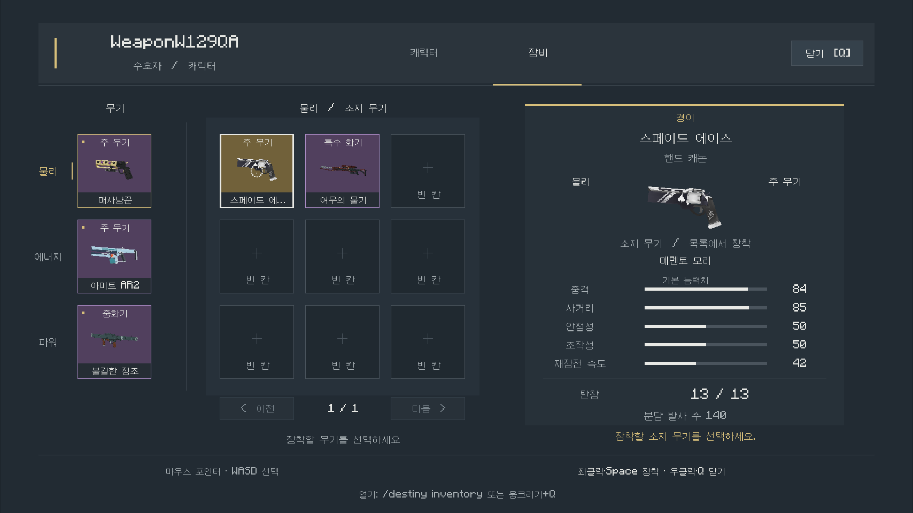

# W227 무기 장비 화면 검증

무기 장비 화면을 DisplayHud로 구현했다. 물리·에너지·파워 실제 장비 칸, 소지 무기 격자, 무기 상세 정보와 한국어 문구를 포함한다. 갑옷은 이번 범위에서 제외한다.

## 작업과 병렬 통합

- master: 화면 세션·입력·전투 차단·수명 관리·한국어 데이터·바닐라 핫바 표현·중앙 검사·Vision.
- 재사용 슬롯4: `WeaponEquipmentService`와 실제 인벤토리 GameTest. 원본 객체를 맞바꾸며 탄약·특성을 보존한다.
- 재사용 슬롯5: `WeaponScreenLayout`·`WeaponScreenHud`와 좌표 검사. 첫 실제 PNG의 글자 위치 문제를 전달한 뒤 한국어·정렬 수정본을 해시 대조해 통합했다.
- 기존 W226 퍽 변경은 보존했으며 이번 기능 커밋에 함께 넣지 않는다. 검증 환경은 기존 미커밋 통합본을 포함하므로 깨끗한 HEAD 단독 재현을 검증했다고 주장하지 않는다.

## 확인 결과

| 구분 | 결과 | 근거 |
| --- | --- | --- |
| 최초 관련 단위 검사·빌드 | 10/10 통과, assemble·compileGametestJava 성공 | `target-2.json` |
| 최초 서버 검사 | 11/11 통과 | `server-2-report.xml` |
| 전체 단위 검사 | 2,061개 중 2,055 통과, 6 실패 | `unit-final.json` |
| 첫 실제 입력 | WASD·시점 포인터·스페이드 에이스 장착·에너지 선택·우클릭 닫기 통과 | `native-r1/sequences/`, `native-r1/oracles/` |
| 한국어 데이터 | 공식 정의에서 65종/65종 이름 확인 | `korean-provenance.json` |
| 한국어·정렬·핫바 표현 수정 후 | 단위10/10·빌드 통과, 서버11/11 통과 | `target-3.json`, `server-3-report.xml` |
| 작은 한글 가독성 수정 후 | 단위10/10·빌드 통과 | `target-4.json` |
| 2차 실제 입력 | 세 분류 실제 장착·WASD·포인터·닫기 통과 | `native-r2/` |
| 2차 화면 검수 | 작은 한글 가독성 문제 발견·수정 요청 | `native-r2-review.json` |
| 3차 최종 검수 | 한국어 가독성·세 분류 실제 장착·입력·닫기 수락 | `native-r3-review.json`, `native-r3/` |

전체 검사의 6실패는 이번에 수정하지 않은 음원·입자 기대값 검사(FireVariantsW98 2개, SoundAssetsW33·NamedAudioW102·SwordAudioW56·ParticleTextureFallbacks 각1개)다. W227 이전 동일 환경의 전체 기준선을 실행한 것은 아니므로 독립적으로 확정된 기존 실패라고 표현하지 않는다. 이번 배치에서 음원·입자 자산은 변경하지 않았다.

경이 충돌 검사는 현재 경이 두 종이 모두 물리 칸이어서 서로 다른 분류의 실제 충돌 분기가 실행되지 않았다. 코드 제한이 존재한다는 것과 실제 충돌을 검증했다는 것을 구분한다.

## 실제 화면 검수

첫 실행에서 장비 격자와 실제 모델·포인터 조작은 확인했으나 글자가 크기에 비례해 위로 치우치고 바닐라 핫바 아이콘·선택 아이템 이름이 메뉴와 겹쳤다. 해당 PNG를 HUD 담당자에게 전달해 글자 baseline 보정과 한국어 폭 맞춤을 받았다. master는 실제 서버 아이템을 비우지 않고 수신자 전용 핫바 표현만 숨기며 닫을 때 복원하도록 수정했다.

2차 실행에서 정렬·겹침 해결과 세 분류의 실제 장착·닫기를 확인했다. 작은 한글 획 소실을 발견해 가독 크기 하한을 높이고, 긴 카드 이름은 글자 크기를 줄이는 대신 말줄임하도록 추가 요청했다. 수정본은 최소18 기준 픽셀·주요 라벨20 픽셀·상세 이름26 픽셀을 유지하고 폭이 넘으면 말줄임한다. 3차 실제 PNG에서 작은 글씨와 카드 이름·능력치·푸터가 읽히는 것을 확인해 수락했다. 세 분류 장착·입력·닫기도 다시 통과했고 lease/키는 중립, 소유 client/server는 종료0, 사용한 두 포트는 해제됐다. 사용자 승인48시간 assertion은 유지했다. 화면은 실제 PNG로 검수하며 서버 상태 JSON이나 입력 수락만으로 시각적 통과를 주장하지 않는다.

## 조작과 한계

- 열기: `/destiny inventory`, 웅크리기+Q. GCB의0키 경로도 연결했다.
- 마우스 회전 패킷이 메뉴 포인터를 움직이며 OS 포인터를 해제하지 않는다. WASD로 선택, 좌클릭·Space로 장착, 우클릭·Q·F·닫기 버튼으로 종료한다.
- 실제 입력은 Vision Client의 바닐라 입력 경로다. 서버 명령은 전용 QA 플레이어의 fixture 구성·열기·상태 관측에만 사용했으며 native 열기 단축키를 검증했다고 하지 않는다.
- 개인 DisplayHud이며 일반 컨테이너·SGUI를 열지 않는다. 메뉴가 열린 동안 이동·사격·능력은 차단한다. 실제 장비는 핫바0·1·2, 보관 후보는 소유 인벤토리0~35다.
- 상세 막대는 기본 능력치이며 활성 전투 버프를 합산하지 않는다. 소지 무기 모델은 기존 GUI 모델을 사용한다.
- 해상도는 실제 QA 프레임 기준이며 모든 종횡비를 실기 검증한 것은 아니다. GCB0키와 페이징·Space 경로의 실제 키 입력은 별도 미검증이다.

## 정리와 출처

Computer Use에서 Finder 데스크톱이 보이는 것을 확인한 뒤 점유되지 않은8102·25611을 사용했다. 격리 QA만 조작하며 일반 프로필은 보존한다. 테스트는 `keep_awake.py`로 감싸고, 별도 사용자 승인48시간 caffeinate PID79904는 유지한다. 소유 client/server와 입력 lease는 실행별로 회수한다.

원본 공식 한국어 정의 전체200MB는 임시 저장소에만 두고, 제품에는 필요한65개 이름과 manifest 버전·URL만 넣는다. 단계별 기록은 `step-log.md`, 구현 설명은 [설계 문서](../../../design/W227_무기_장비_화면.md)에 있다.
