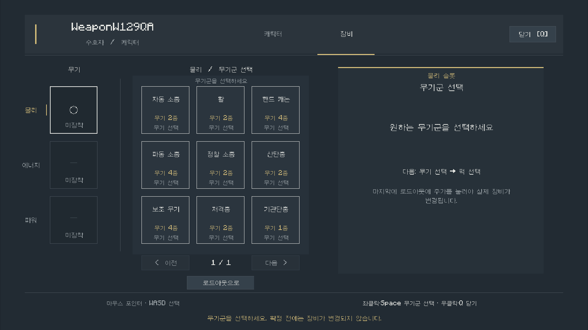

# W228 슬롯별 무기 구성 검증

사용자가 지정한 **슬롯 → 새 무기 → 무기군 → 무기 → 퍽 → 로드아웃에 추가** 흐름을 DisplayHud에 통합했다. 최종 확정 전에는 실제 장비를 변경하지 않고, 뒤로·닫기는 작성 중 선택을 버린다. 실제 native 입력과 PNG 검수까지 마쳤다.

## 구현과 분담

- master: 세션·단계 전환·입력·실제 확정 호출·한국어 데이터·중앙 검사·Vision·커밋.
- 고정 슬롯4: 테스트 무기 서비스·정확한 퍽 tuple 구성·인벤토리 보존·GameTest.
- 고정 슬롯5: 단계별 HUD·View·공통 좌표·숨긴 버튼의 hit/navigation 차단.
- 기존 워크트리를 재사용했다. 각 worker의 전체 입력 기준선과 소유 경로 hash를 대조하고, 범위 밖 변경이 없음을 확인했다. 이전 작업의 dirty/untracked 통합본과 원본 자산은 보존한다.

## 자동 확인

| 검사 | 결과 | 근거 |
| --- | --- | --- |
| 관련 단위·빌드·GameTest 컴파일 | 21/21 통과 | `target-1.json`·`target-2.json`·`target-ui-3.json` |
| 최종 assemble | 성공 | `package-final.json` |
| W228 서버 | 8/8 통과 | `server-w228-2-report.xml` |
| W227 장비·입력·소유권 회귀 | 11/11 통과 | `server-w227-after-click-fix-report.xml` |
| 전체 단위 | 2,072개 중2,066개 통과·6실패 | `unit-final.json` |

전체 단위 실패6개는 W227과 동일한 검사 집합(FireVariantsW98 2개, SoundAssetsW33·NamedAudioW102·SwordAudioW56·ParticleTextureFallbacks 각1개)임을 비교했다. 이번에 음원·입자 자산을 바꾸지 않았지만, 깨끗한 전체 기준선을 새로 확정한 것은 아니다. 전부 통과했다고 표현하지 않는다.

첫 서버 실행의 넓은 필터는 W226도 포함해21개 중2개가 실패했다. W228 장전 fixture는 기존7틱 Handling 준비 마감 전에 장전을 요청한 문제라 제품 코드 변경 없이 실제 마감까지 기다리도록 수정했다. 이후 정확한 W228 검사8개가 모두 통과했다. W226 Cornered 충전 마감 검사 실패는 별도 기존 통합 범위로 남기며, W227·W228 정확 필터가 통과한 것과 구분한다.

서버 검사는 초안의 인벤토리 무영향·잘못된 조합의 변경 전 거부·정확한 슬롯과 퍽 최종 적용·원본 객체/탄약/다른 컴포넌트 보존·빈 보관 공간이 없는 경우 거부·동일 무기 재선택·소유자 표식 보호를 포함한다. 단순 수치 퍽77개를 각각 검사하지 않았다.

전체 단위 검사는 연속 클릭 수정 전 실행했다. 이후 입력 수정은 관련 단위21개·W227 서버11개와 최종 native로 다시 검사하며, 마지막 HUD 변경은 초안 문구 한 줄뿐이다. 같은 음원·입자 실패를 재확인하기 위한 전체 반복은 하지 않는다.

## 실제 입력과 화면

두 번째 격리 Vision 배치가 통과했다. 서버 명령은 전용 QA 계정의 fixture 구성·열기·관측에만 사용하고, 무기군·무기·퍽 선택·해제·확정·뒤로·닫기는 Vision Client의 바닐라 native 입력 경로를 사용했다.

- 첫 실행에서 같은 좌표의 무기→퍽 클릭을 막던 armed 래치를 발견해 제거했다. 틱별 중복 패킷 차단은 유지한다. 수정 후 실제 같은 위치 클릭이 통과했고,24틱 클릭 유지 후에도 WEAPON 단계가 유지돼 연쇄 진입하지 않았다.
- 물리 매사냥꾼(핸드 캐논)·에너지 은둔자(기관단총)·파워 결투 규칙(로켓 발사기)을 무기군에서 골라 실제 슬롯에 추가했다.
- 매사냥꾼은 광폭+강박적인 재장전기를 고른 뒤, 확정 전 실제 Inventory=[]임을 확인했다. 최종 추가 뒤 슬롯0과 정확한 두 소켓 hash(3:671806388,4:4104185692)가 기록됐다.
- 다른 무기의 초안을 만들었다가 뒤로 취소한 후 실제 인벤토리 payload가 이전 값과 완전히 같았다. 소켓 충돌 선택은 이유를 표시하고 기존 두 선택을 유지했다. 데미지 없음은 유틸리티를 보존했다.
- 한글·단계 안내·원작 설명·초안/확정 구분·버튼 간격·세 슬롯 실제 장착을 실제 PNG로 검수했다. 초안의 현재 적용 중 문구를 초안에 저장됨으로 수정해 다시 확인했다.
- WASD가 메뉴만 조작하고 본체 이동을 만들지 않음, 우클릭 닫기, 중립 lease/키, 소유 process 종료0·8102/25611 해제를 확인했다. 사용자48시간 assertion은 유지했다.

근거: `native-r2/assertions.json`, `native-r2/fixtures/`, `native-r2/sequences/`, `native-r2-review.json`, `native-r2-cleanup.json`. 대표3무기의 메뉴를 확인한 것이며65종의 모델·장전·전투나 모든 해상도·지형에서의 입력을 전수 검증한 것은 아니다. OS 클릭이나 실제 청취를 이번 결과로 주장하지 않는다.

## 출처와 범위

제품에는 공식 한국어 이름·원작 설명77개만 포함한다. 데미지22·유틸리티55 분류이며 원작 설명 전체가 Minecraft 구현과 동일하다는 보증이 아니다. 원본200MB와 복구 ZIP·런타임·모델/음원 추출물은 이번 커밋에 넣지 않는다.

검증 환경은 기존 미커밋 통합본을 포함한다. 깨끗한 HEAD만으로 전체 제품이 재현된다고 주장하지 않는다. `WeaponPerks.java`는 이번 전부터 존재하던 미추적 입력이라 HEAD에 삽입 부분만 stage할 수 없다. 필요한 변경 의존 파일로 최초 추적하며, 저장한 입력과 비교해 이번 수정이 정확한 tuple 교체 메서드 삽입뿐임을 확인했다. 다른 무관한 미커밋 엔진·자산을 일괄 stage하지 않는다.

시작 전 Computer Use에서 Finder 데스크톱 접근과8102·25611 미점유를 확인했다. QA coordinator만1800초 awake wrapper로 감싸며, 사용자 승인48시간 caffeinate PID79904는 보존한다. 일반 프로필·앱·인증 설정은 변경하지 않는다.

커밋에는 범위를 지정한 제품15개 파일과 구조화된 QA·XML·PNG 증거만 포함한다. `.gitignore`가 제외하는 원본 `.log`는 로컬 QA 폴더에 보존하고, 패키징 때 중복 복사된 `package-final-junit/`와 내부 `contract.md`는 stage하지 않는다. 공유 레지스트리는 HEAD에 W228 변경만 더한 blob을 stage했으며, 작업본의 다른 미커밋 항목은 유지한다(`partial-stage-plan.json`).
