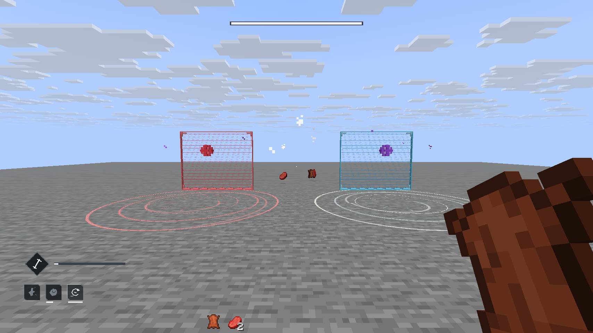

# W229 타이탄·워록 통합 QA

현재 상태: W229 구현과 2차 실게임 검수를 수락했다. 대혼란의 주먹 전용 원본과 실제 PvP 관전자별 색 선택은 후속 작업이다. 전체 단위 gate에는 기존 실패 6개가 남아 있다.

## 범위와 작업 순서

두 직업의 점프·직업능력·3속성 수류탄/근접/궁극기22개를 등록했다. 모델/모션은 SSD `.blend` 직접 평가 → 61pose → 1차 native PNG → 담당 worker 검수/수정 → 통합 후 2차 native 순서다. master만 중앙 Gradle/서버/client/lease/CU를 운영했다. 고정 워크트리4/5를 재사용하고 삭제하지 않는다.

사용자 추가 요구인 신성폭탄·방벽·균열 모델, 타이탄 다리 고정, 새벽칼날 발동 자세 고정, 향후 PvP 적군용 붉은 텍스처를 함께 추적한다. 적군 자산 생성과 실제 PvP 대상/팀/관전자 라우팅은 구분한다. 현재 `Combat.isEnemy`는 플레이어를 공격 대상으로 삼지 않는다.

## 검사 기록

| 검사 | 현재 결과 | 근거 |
|---|---|---|
| 1차 타입/패키징·GameTest 컴파일 | 통과 | target-compile-r2.json |
| R1 자산3검사 | 3/3 통과 | target-ui-assets.json |
| R1 서버 | 12/23 통과, 11실패 보존 | server-w229-report.xml |
| 1차 native 입력·실제 PNG | 실시, 하체고정 결함 발견/반환 | native-r1/review.md |
| locomotion 공유Java 컴파일·패키징 | 통과, 이후 R2 통합 전 | target-locomotion-r2.json |
| R2 자산/타입·GameTest 컴파일 | 3/3 통과 | target-ui-assets-r2.json |
| R2 서버 | 20/23 통과, 3개 fixture 수정 후 R3 실시 | server-w229-r2-report.xml |
| R3 서버 | 23/23 통과 | server-w229-r3-report.xml |
| 최종 단위 회귀 | 2,069/2,075 통과, 기존 실패와 같은 6개 검사 | final-full.json, regression-comparison.json |
| 최종 패키징 | assemble 통과 | package-final.json |
| 2차 native·실제 PNG | 두 직업 능력·궁극기·이동 및 일반/적군 전시 검수 완료 | native-r2/review.md, assertions.json, 담당 worker 검수 |

R1 melee6개는 native 전송은 됐지만 서버 cooldown0이었다. 수락 통과로 세지 않고 R2에서 sneak2tick 준비 후 attack을 분리한다. 오디오17고유 OGG/18매핑은 decode·packet 연결과 실제 청취를 구분한다. 숫자파일의 역할은 잠정이다.

최종 실패 집합은 W228 `unit-final.json`과 동일하다. 다섯 오디오 검사는 과거 고정 목록/개수와 누락된 기존 `w210/shotgun/insert`를, 파티클 검사는 과거 HUD 복구 개수 98을 기대한다. 신규 음원·HUD 추가로 일부 실패 메시지의 실제 개수도 달라졌으므로 메시지까지 동일하다고 주장하지 않는다. 전체 gate를 통과로 바꾸거나 기대를 느슨하게 고치지 않았다. `failure-baseline-comparison.json`에 메시지를 보존했다. test 실패로 후속 assemble이 중단되어 패키징만 별도로 실행했고 성공했다.

왼쪽이 적군용 붉은 변형, 오른쪽이 일반색이다. 이는 정적 item display 전시이며 실제 PvP 팀별 표시 근거가 아니다. 실게임 이동 비교는 `native-r2/locomotion-review.jpg`에 있다.

## 모델·모션 출처

Hammer221/Shield342/Daybreak211요소는 실제 원본을 의미 있는 입체와 UV로 재작성한 소품이다. Nova38cube, 방벽89, 균열101은 자체 제작 임시VFX다. 최대1000요소 제한 이하다. 복제 enemy 텍스처는 geometry/UV/alpha를 보존한다.

20클립: 실제 source motion·source snapshot·명시 authored gait를 provenance에서 구분한다. 새벽칼날 대기는 일반 sword-catch80A8B370을 호환 리그에서 검토한 임시 캐리 루프이며 Daybreak 전용 state 연결은 미식별이다. 이동과 공중 하체를 분리했다. 파수병 sprint80A8A9AD 하체는 전용 source다. Fists of Havoc 전용 source는 사용자가 추후 전달하기로 했으며 헌터/Thundercrash로 대체하지 않았다.

최초 R2의 다리 parent 오류4클립을 별도 CAS 수정본으로 반영했다. 게임에서 이미 생성된 파일을 덮어쓰지 않도록 설치ID는 `guardian_classes_w229_r3`이다. 61pose는 근사 보간이며 원작60fps 완전 재현 인증이 아니다.

## 수치와 남은 자료

DDC15행의 기본 시간/조건은 `art/classes/w229/sources/ddc-class-values.md`와 evidence JSON에 있다. 적용한 초 단위는20TPS로 변환한다. Titan/Warlock 기본 궁극기 충전은 장착 tuning시간을 기존passive경로에 연결하며 kill추가충전은 별도다. HP·거리·스탯별 회복·공격 에너지소모는 아직 MC임시환산이며 DDC전수확인으로 주장하지 않는다.

## 실행 환경과 보존

Minecraft26.3, FabricLoader0.19.5, Java25, Polymer0.18.4+26.3, BetterModel3.5.1. 격리서버 `/private/tmp/destiny-w229-server`, client포트8102/server25611. 일반 Minecraft 프로필·월드와 Blender/Blockbench·SSD원본을 보존한다. secret은 client relay환경에만 생성하고 보고/커밋에 넣지 않는다.

통합 checkout에는 작업 전부터 대규모 미커밋·untracked 변경이 존재한다. 검증은 그 통합 작업본 기준이며 깨끗한 HEAD만의 재현을 주장하지 않는다. `master-baseline.json`과 외부before복구본으로 W229 경계를 기록한다. 커밋은 명시한 관련 경로만 선택하며 원본archive·rawruntime·수천PNG를 넣지 않는다.

공유 애니메이션의 기존 dirty 의존 API는 `commit-prerequisite-review.md`에서 분리했다. 직접 필요한 지원 파일을 명시적으로 포함하되 전체 무기 카탈로그·빌드 설정·이전 미커밋 자산을 일괄 checkpoint하지 않는다. 선택 경로/부분 stage 내역은 `commit-scope.json`에 남긴다. 두 고정 워크트리 4/5는 삭제하지 않고 `idle-needs-refresh`로 유지한다.
